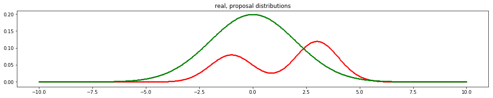
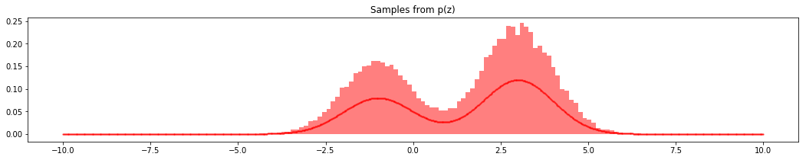

# Sampling Methods

Four small notebooks exploring sampling methods from **Pattern Recognition and Machine Learning (PRML)**: rejection sampling, importance sampling, sampling–importance–resampling, and Metropolis–Hastings.

[Browse the examples](#notebooks) · [Start with resampling](sampling-importance-resampling.ipynb) · [Implementation notes](docs/NOTES.md)




*Proposal and target, followed by the resampled histogram. These are saved outputs from [sampling–importance–resampling](sampling-importance-resampling.ipynb). The target curve is unnormalized, so its height differs from the normalized histogram.*

## Notebooks

| Method | Example | Main idea |
| --- | --- | --- |
| Rejection sampling | [reject sampling.ipynb](reject%20sampling.ipynb) | Accept or reject proposals using an envelope over a bimodal target |
| Importance sampling | [importance sampling.ipynb](importance%20sampling.ipynb) | Weight samples from a proposal to estimate an integral |
| Sampling–importance–resampling | [sampling-importance-resampling.ipynb](sampling-importance-resampling.ipynb) | Draw proposals, normalize importance weights, and resample |
| Metropolis–Hastings | [metropolis-hastings.ipynb](metropolis-hastings.ipynb) | Explore a proposal-and-acceptance sampling loop |

## Open locally

The examples construct their distributions in code; no dataset download is needed. They use **NumPy, SciPy, Matplotlib, and Jupyter**. The Metropolis–Hastings notebook also imports `tqdm`.

```sh
git clone https://github.com/scpark20/sampling-methods.git
cd sampling-methods
python -m pip install jupyter numpy scipy matplotlib tqdm
jupyter notebook
```

These are historical learning notebooks with Python 3.6.3 recorded in their metadata. Review the [implementation notes](docs/NOTES.md) before rerunning: they identify a removed NumPy argument, normalization details, and corrections needed in the Metropolis–Hastings example. The documentation update preserves the original code and saved figures.

<details>
<summary>Full project notes</summary>

<!-- preserved-project-notes:start -->
# sampling-methods
sampling methods implementation from PRML

<!-- preserved-project-notes:end -->

</details>
